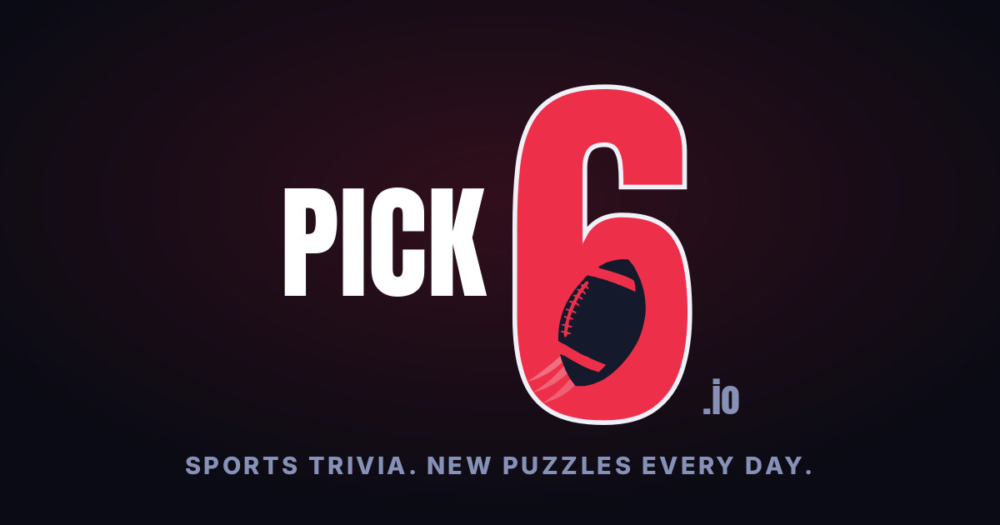
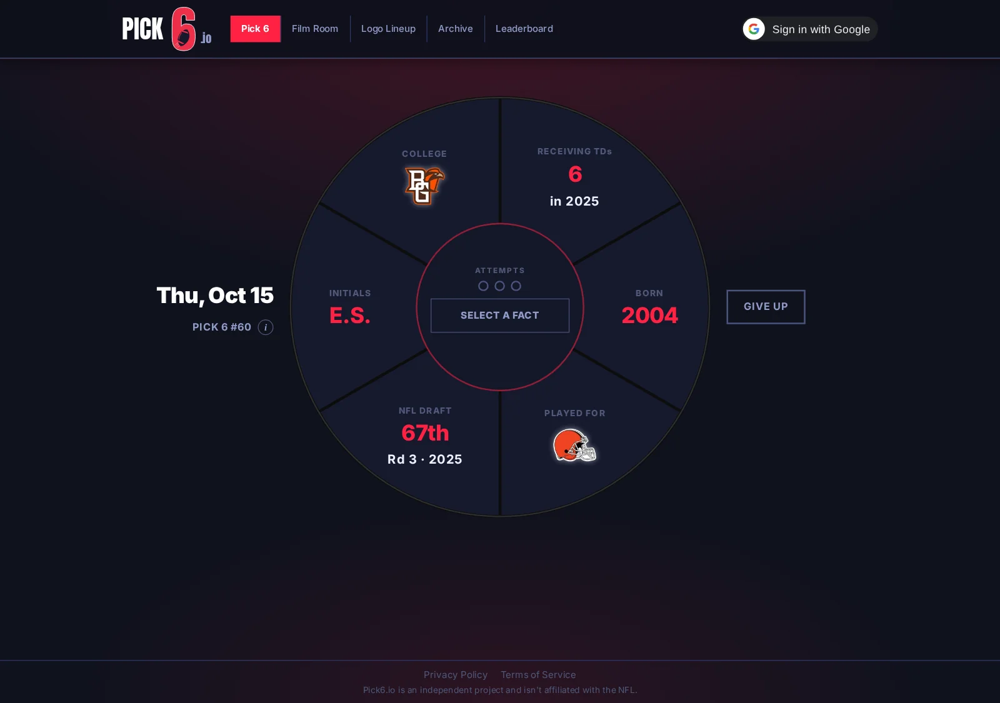
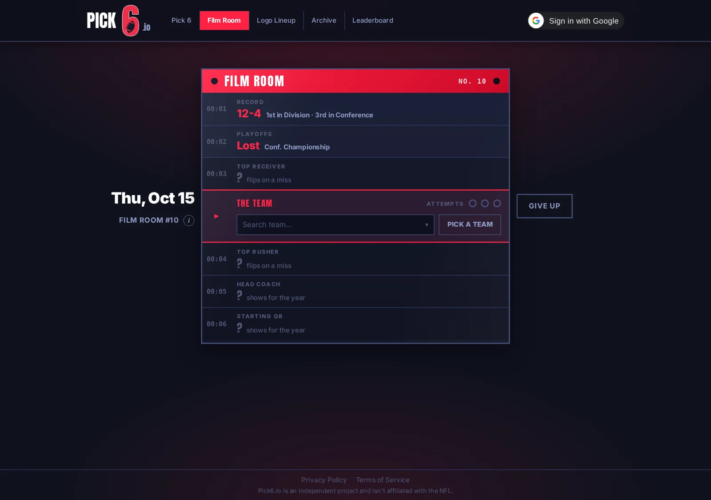
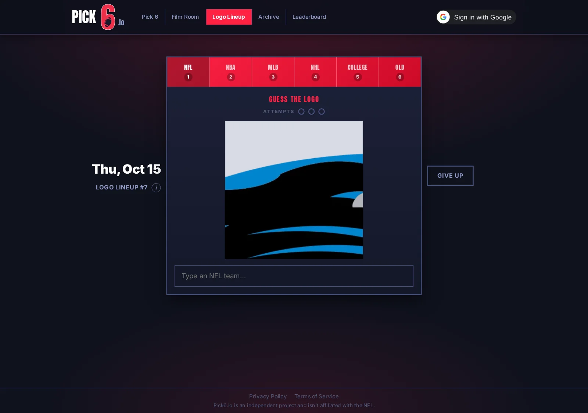

# Pick6.io

Three daily sports trivia games, each scored out of 6:

- **Pick 6:** six facts about a mystery NFL player, one of them a lie. Spot the lie, name the player. Whiff on both and it's a Pick Six.
- **Film Room:** six clues about one NFL team's season. Guess the team, then the year.
- **Logo Lineup:** six logos zoomed way in, one each from the NFL, NBA, MLB, NHL and college, plus one old logo. Name the teams.



## Screenshots

<table>
<tr>
<td width="33%"></td>
<td width="33%"></td>
<td width="33%"></td>
</tr>
</table>

## How it works

- A new puzzle for each game every day, max score **6 points** in each
- Missed a day? Past puzzles stay playable in the archive
- Sign in with Google to save your results across devices, appear on each game's leaderboard, and see your per day stats on your profile
- Each game's rules are behind the **i** next to its puzzle number

### Pick 6

- Each puzzle features a currently active NFL player
- **+3 pts** for naming the correct player · **+3 pts** for spotting the lie (drops by 1 per wrong attempt, min +1)
- Miss both and it's a Pick Six

Facts are generated from a player's real record, so the lie has to sit convincingly among them:

| Group | Facts |
|-------|-------|
| Profile | College, draft round/pick/year, jersey number, birth year, initials, teams played for |
| Career stats | Passing yards & TDs, rushing yards, receiving yards & TDs, sacks, interceptions |
| Accolades | Super Bowls, Pro Bowls, All-Pro, MVP, Heisman, Hall of Fame, OROY/DROY/OPOY/DPOY/CPOY |

Each lie is a plausible near miss rather than a wild one. A stat lie keeps the real number and swaps the season, a draft lie nudges the round or year, and an initials lie borrows the initials of a real player at the same position.

### Film Room

Built for casual fans who don't know every player. Each puzzle is one memorable NFL team season since 2002, laid out like a coach's call sheet.

- Only the record and playoff finish start face up. Each wrong team guess flips the next clue (top receiver, then top rusher)
- **+3 / +2 / +1** for getting the team on the 1st, 2nd or 3rd attempt
- Then every clue shows, including the head coach and starting QB, and you guess the year: **+3** exact, **+1** one year off
- The reveal shows the logo the team actually used that season

### Logo Lineup

For really casual fans. Six logos a day, each zoomed in 5x.

- One current logo each from the NFL, NBA, MLB, NHL and college (Power 4 + Notre Dame), plus one old logo from any of them
- 3 attempts per logo, every miss zooms out. **+1** per logo you get
- Play the logos in any order, and Give Up only gives up on the logo you're on

## Tech stack

| Layer | Technology |
|-------|-----------|
| Frontend | React + Vite |
| API | Node.js / Express |
| Database | PostgreSQL (AWS RDS) |
| Auth | Google Sign-In, JWT session cookie |
| Awards data | `public/awards.csv` — scraped from Wikipedia |
| Film Room data | `nfl_data_py` / `nflreadpy` schedules and weekly stats plus nflverse standings, built into `api/data/team_seasons.json` |
| Logos | Official league SVGs (NFL, NBA, MLB, NHL, NCAA) and old logos from sportslogos.net, cropped server-side with `sharp` |
| Deployment | Vercel (frontend) · Render (API) |

Answers are withheld server-side in every game. Pick 6 strips the player's name, the lie, and the reveal portrait until they've been earned, Film Room only sends the clues you've unlocked, and Logo Lineup sends a pre-cut crop at the zoom level you've reached instead of the full logo. Daily answers are shuffled with a server secret, so the public repo doesn't give away future puzzles.

## Developer docs

How the code works, how to deploy it, and what's planned next live in [`docs/`](docs/README.md).

## Project structure

```
├── src/                  # React frontend
│   ├── components/       # GameBoard (Pick 6), FilmRoomBoard, LineupBoard, Header, HowToPlay, Archive, Leaderboard, Profile, Admin, ...
│   ├── utils/            # factDisplay, teamLogo, collegeLogo, franchises
│   └── App.jsx
├── api/                  # Express API server
│   ├── index.js          # Pick 6 + account routes, security middleware
│   ├── auth.js           # Google sign-in, sessions, admin gate
│   ├── puzzle.js         # Pick 6 puzzle generation logic
│   ├── filmroom.js       # Film Room
│   ├── lineup.js         # Logo Lineup, including the server-side logo crops
│   └── data/             # Film Room seasons + Logo Lineup team and old logo lists
├── public/
│   ├── awards.csv        # HOF, Pro Bowl, All-Pro, MVP, OPOY, DPOY, ROY, CPOY (1957–2025)
│   ├── logos/            # NFL team + college logos, NFL era logos, Logo Lineup logos
│   └── og-image.png      # Social share preview image
├── docs/                 # developer docs — start at docs/README.md
│   └── screenshots/      # README screenshots
├── scripts/              # Data loading, Film Room + Logo Lineup builders (Python)
├── render.yaml           # Render deployment config (API)
└── vercel.json           # Vercel deployment config (frontend)
```
